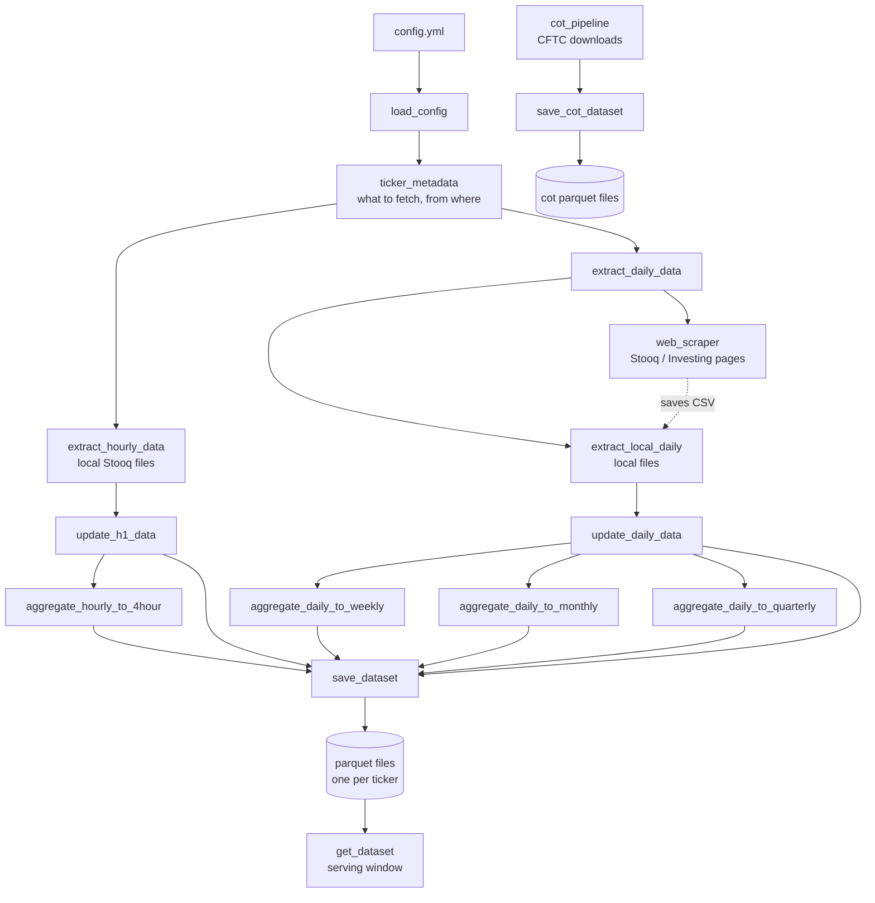

# forexdatasets

> **The "pantry" of a three-package trading system.** It collects raw price data, keeps it fresh, stores it in fast parquet files, and hands it out on request.

`forexdatasets` is the first of three planned packages:

| Package | Job | Status |
|---|---|---|
| **forexdatasets** (this one) | Collect, store and serve raw data | In progress |
| `forexengine` | Analysis and back-testing. It will call `get_dataset()` | Planned |
| `forexviz` | Shiny app and charts (kept apart because of Shiny) | Planned |

A `{targets}` project will sit on top and link the three together.

---

## Table of contents

1. [What this package does](#1-what-this-package-does)
2. [The big picture](#2-the-big-picture)
3. [Quick start](#3-quick-start)
4. [Where the data comes from](#4-where-the-data-comes-from)
5. [Stooq in detail (and why the manual download)](#5-stooq-in-detail-and-why-the-manual-download)
6. [The pipeline, step by step](#6-the-pipeline-step-by-step)
7. [Where files are stored](#7-where-files-are-stored)
8. [Getting data back out: `get_dataset()`](#8-getting-data-back-out-get_dataset)
9. [COT reports](#9-cot-reports)
10. [Column dictionary](#10-column-dictionary)
11. [The config file](#11-the-config-file)
12. [Function reference](#12-function-reference)
13. [Where this README sits in the package](#13-where-this-readme-sits-in-the-package)
14. [Testing](#14-testing)
15. [Design rules](#15-design-rules)
16. [Known issues and things to review](#16-known-issues-and-things-to-review)
17. [Responsible use](#17-responsible-use)
18. [Sources](#18-sources)

---

## 1. What this package does

> 💡 **Plain English:** think of a shop's back room. Boxes arrive (raw files). Someone opens them, checks them, and puts each item on the right shelf (parquet files). When a customer asks for something, the shop assistant (`get_dataset()`) fetches it from the shelf.

This package does four jobs:

1. **Extract** raw price data from local files and from the web.
2. **Update** what is already stored: add only the new rows, remove duplicates, keep history safe.
3. **Aggregate** hourly data into H4, and daily data into weekly, monthly and quarterly.
4. **Store and serve** everything as one parquet file per ticker, plus a function to read it back.

It also downloads and stores the CFTC **Commitments of Traders (COT)** reports.

> ⚠️ **Raw data only.** This package does *not* calculate returns, volatility, pip values or any other metric. Those belong in `forexengine`. The package only gathers, cleans, merges, labels and stores.

**Timeframes:** H1, H4, daily, weekly, monthly, quarterly.

**Ticker counts:** 40 tickers for H1 and H4. 61 tickers for daily (and so weekly, monthly, quarterly), across 6 asset classes.

---

## 2. The big picture



Every function takes the output of the one before it. Functions that **read** or **write** files always ask one helper, `build_data_path()`, where a file lives. So the saver and the readers can never disagree.

---

## 3. Quick start

### Install (from the package folder)

```r
# install.packages("devtools")
devtools::load_all()      # while developing
# or
devtools::install()       # to install it
```

### Run the pipeline for one timeframe

```r
library(forexdatasets)

config <- load_config()          # reads the config that ships inside the package
meta   <- ticker_metadata(config)

# ---- H1 ----
h1_rows <- meta[frequency == "hourly"]
h1_new  <- data.table::rbindlist(lapply(seq_len(nrow(h1_rows)), function(i) {
  extract_hourly_data(h1_rows[i], h1_rows$source_path[i], config)
}))

h1_all <- update_h1_data(h1_new, config)   # merge with what is already stored
h4_all <- aggregate_hourly_to_4hour(h1_all, config)

save_dataset(h1_all, config)
save_dataset(h4_all, config)
```

> 📝 **Note:** the loop above shows the idea. In your own setup the `{targets}` project runs these steps. The `frequency` value and the exact filter come from your `config.yml`.

### Read data back

```r
get_dataset("daily")                                        # everything
get_dataset("h1", ticker = "audcad", from = "2024-01-01")   # one ticker, from a date
get_dataset("daily", asset_class = "Metals",
            columns = c("close", "volume"))                 # only some columns
```

---

## 4. Where the data comes from

There are three sources.

| Source | What it gives | How it arrives | Used for |
|---|---|---|---|
| **Stooq bulk download** | H1 and daily files | **Manual download** (you click, you unzip, you place the files) | Currency pairs, currency indices, metals |
| **Stooq / Investing web pages** | Daily tables | **Web scraping** with a headless browser (`chromote`) | Futures (commodity and currency) |
| **CFTC** | COT reports (zip files) | Direct download (`download.file`) | COT data |

### Why two ways to get price data?

* **Local (manual):** Stooq does not like scripts. So the bulk files are downloaded by hand and dropped in a folder. The package then reads them.
* **Web (scraped):** for futures, the package opens the page in a hidden Chrome, waits for the table, copies it, and **saves it as a CSV in the local folder**. After that, the same file can be read by the local reader next time.

### What each asset class has

| Asset class | H1 | Daily |
|---|:---:|:---:|
| Currency_Pairs (28 tickers on H1) | ✅ | ✅ |
| Currency_Indices (8 on H1) | ✅ | ✅ |
| Metals (4 on H1) | ✅ | ✅ |
| Commodity_Futures | ❌ | ✅ |
| Currency_Futures | ❌ | ✅ |
| One more class defined in `config.yml` | ❌ | ✅ |

H1 only exists for the first three classes. Futures tickers look like `cb.f`, `gc.f`, `pa.f`.

---

## 5. Stooq in detail (and why the manual download)

> 🔎 **Research note (checked 3 November 2026).** I could not open `https://stooq.com/db/h/` with an automated tool: the site refuses automated access. That fits your own experience. What follows comes from third-party write-ups, so please check the page yourself in a normal browser before relying on any detail.

### What the page is

`stooq.com/db/h/` is Stooq's **historical data download page**. It offers zipped bulk files. Third-party guides describe it like this:

* You pick a **region** (for example U.S.) and a **frequency** (daily, hourly, 5-minute). Each choice gives you a zip of many small text files, one per symbol. One guide says a single daily download can cover more than 11,000 symbols.
* Inside the zip there is a folder tree such as `data/daily/us/nasdaq stocks/1/aapl.us.txt`. Stooq publishes the folder layout it prefers.
* Stooq does **not** offer a real programmatic API for this. A tutorial on loading Stooq data says so plainly.

### How deep is the history?

| Frequency | How far back (per third-party reports) | What this means for you |
|---|---|---|
| Daily | Long history | Fine to rebuild from scratch |
| Hourly | About 1,400 data points, roughly 7 to 9 months | **You cannot rebuild old hours later.** Old H1 history only exists because *you stored it* |
| 5-minute | About 2,000 points, roughly 1 month (some sources say ~15 days) | Not used here |

> 💡 **This is the key reason `update_h1_data()` exists.** Each manual download only covers recent months. The update step compares the new file against your stored parquet file, keeps only the **new** candles, and adds them to the old history. If you skip the monthly download for too long, you will have a **gap** that cannot be filled from Stooq.

### Why Stooq blocks scripts

There are signs that Stooq limits automated use:

* Users of the Wealth-Lab Stooq provider report a **low daily request quota**. When it is used up, Stooq returns the text "Exceeded the daily hits limit" instead of data.
* Single-symbol CSV downloads go through a `q/d/l` address, and that is the path that gets the quota message.
* The bulk zip files are the route Stooq seems to expect heavy users to take.

### What this means for the package

1. **Do not script the bulk download.** Keep it manual. It is a few clicks a month, and it is the kind of access Stooq accepts.
2. **Download on a schedule.** Because H1 only reaches back months, set a reminder (for example every 4 to 6 weeks).
3. **Keep the raw downloads.** Never delete your zip files until the parquet check passes.
4. **Scraping is the fragile part.** Page layout, timeouts and the daily limit can all break it. See [Known issues](#16-known-issues-and-things-to-review) and [Responsible use](#17-responsible-use).

### What a Stooq local file looks like

Stooq text files typically have header names like `<DATE>`, `<TIME>`, `<OPEN>`, `<HIGH>`, `<LOW>`, `<CLOSE>`. The package reads them with `fread(select = ...)` and renames them using `config$data_format$column_mapping`. After renaming, the code builds one timestamp from a `date` value like `20241231` and a `time` value like `150000`:

```r
as.POSIXct(sprintf("%s%06d", date, time), format = "%Y%m%d%H%M%S", tz = "UTC")
```

The `%06d` pads the time to six digits, so `0` becomes `000000`.

---

## 6. The pipeline, step by step

### Step 1: Config (`01_config.R`)

* `load_config()` reads `config.yml` and **checks it hard** before anything runs: top-level sections, the `paths` keys, `web` keys, the `{ticker}` placeholder in URL patterns, column mappings, and every asset class. It also checks that `local_base` exists on disk. A bad config stops early, with a clear message.
* `ticker_metadata(config)` builds one table with a row for every combination of **asset class × ticker × frequency × source**. Each row has a `source_path`, which is either a file path (local) or a URL (web).

Columns returned: `asset_class`, `ticker`, `frequency`, `type`, `data_source`, `extract_flag`, `source_path`.

Special cases handled:

| Case | What happens |
|---|---|
| **Currency pairs** | Split into `major` and `other` (using `other_tickers` in config); each type has its own subfolder |
| **Futures** | Can have several sources: `stooq`, `investing`, `local_stooq`, `local_investing`. The generic `local` is expanded into one row per local sub-source |
| **Investing.com tickers** | Mapped through a parallel `investing_tickers` list. A length mismatch gives a warning |
| **Anything else** | One source, flat folder |

### Step 2: Extract (`02_extract.R`)

| Function | Reads | Returns |
|---|---|---|
| `extract_hourly_data(ticker_row, source_paths, config)` | One local H1 file | `date_time, open, high, low, close, timeframe, ticker, asset_class` |
| `extract_daily_data(ticker_row, sources, config)` | **Router:** sends to local or web | Daily table |
| `extract_local_daily()` *(internal)* | One local daily file | Daily table with `volume` and `open_interest` |
| `web_scraper()` *(internal)* | A web page | Raw table, also saved to CSV |

How `extract_daily_data()` chooses:

```
data_source is "local" or "local_stooq"  → extract_local_daily()
data_source is "stooq" or "investing"    → web_scraper()
anything else                            → error logged, returns NULL
```

**Local daily has two formats:**

* **Futures** files (the saved web tables): dates look like `31 Dec 2024`, and volume and open interest have commas, which are stripped.
* **Other** files (Stooq bulk): date and time columns are joined; `volume` and `open_interest` are empty integers.

Both drop anything before **1 January 1985**.

**How `web_scraper()` works:**

1. Open a polite session (`polite::bow`) and check `robots.txt` with `robotstxt`. If the path is not allowed, stop and return `NULL`.
2. Start a headless Chrome (`chromote`), set the user agent and screen size.
3. Go to the URL and **wait** (up to 15 seconds, checking every half second) for the table to appear.
4. Copy the table's HTML, close the browser, parse it with `rvest`.
5. Save it to a CSV in the local folder and return it.

Every extract function returns `NULL` and logs the error if something fails. It does not crash the whole run.

### Step 3: Update (`03_dataupadate.R`)

> 💡 **Plain English:** you hand over a stack of new rows. The function looks at the shelf, sees what is already there, and adds only what is new.

`update_h1_data(hourly_table, config)` and `update_daily_data(daily_table, config)` do the same job:

1. **Check the input**: must be a `data.table`, must have all required columns, config must have `paths$output_base`.
2. **Remove duplicates** by `ticker` + `date_time`.
3. **Load the existing parquet file** for every ticker (path from `build_data_path()`).
4. **Check the old files strictly.** They **stop with an error** (naming the file) if a file is unreadable, lacks core columns, has missing dates, or has dates that cannot be read as date-times. Missing label columns (`timeframe`, `ticker`, `asset_class`) are re-added.
5. **Anti-join:** keep only rows not already stored.
6. If nothing is new, return the old data as it is.
7. Otherwise **merge, de-duplicate, sort** by ticker, asset class, date, and force the UTC time zone.

> ⚠️ **H1 only:** candles stamped exactly `00:00:00` are **dropped on purpose**.

> 📝 These functions **return a table. They do not write files.** Writing is `save_dataset()`'s job.

### Step 4: Aggregate (`03_dataupadate.R`)

All four functions check their input hard (data.table, config, required columns, POSIXct dates, no `NA` in prices) and stop with a clear message if something is wrong. Negative prices only give a warning.

| Function | From → To | Rule for open / high / low / close | Volume / open interest | Date label |
|---|---|---|---|---|
| `aggregate_hourly_to_4hour()` | H1 → H4 | first / max / min / last | not used | End of the 4-hour window (`ceiling_date`); if that lands on exactly midnight, it is moved back **1 minute** |
| `aggregate_daily_to_weekly()` | daily → weekly | first / max / min / last | volume summed, open interest = last | Start of the week, **Monday** (`week_start = 1`) |
| `aggregate_daily_to_monthly()` | daily → monthly | same | same | First day of the month; if that is Sat or Sun, moved to **Monday** |
| `aggregate_daily_to_quarterly()` | daily → quarterly | same | same | First day of the quarter; Sat/Sun moved to **Monday** |

The window sizes (`h1_to_h4`, `daily_to_weekly`, and so on) come from `config$transformation$aggregation`.

> 🔎 The H4 label rule is my reading of the code. Check it against how you want your H4 candles to be stamped.

### Step 5: Save (`save.R`, `paths.R`)

`save_dataset(dt, config)`:

1. Checks the table: not empty, has `date_time`, `timeframe`, `ticker`, `asset_class`; `date_time` is POSIXct **in UTC**; it holds **exactly one** timeframe.
2. Removes duplicate candles (the newest copy wins) and sorts.
3. Works out every file address first. If the config is wrong, it stops **before** writing anything.
4. Writes **one parquet file per ticker**, compressed with `zstd`.
5. **Safe write:** it writes to a `.tmp` file first and then renames it. If something fails, the half-written file is deleted. A crash cannot leave a broken file where a good one used to be.

It returns the written paths (invisibly).

---

## 7. Where files are stored

```
<output_base>/
├── h1/
│   ├── Currency_Pairs/    audcad_<suffix>.parquet, ...
│   ├── Currency_Indices/
│   └── Metals/
├── h4/
├── daily/
│   ├── Currency_Pairs/
│   ├── Currency_Indices/
│   ├── Metals/
│   ├── Commodity_Futures/ gc.f_<suffix>.parquet, ...
│   └── ...
├── weekly/
├── monthly/
├── quarterly/
└── cot/                   one parquet per COT report type
```

The exact rule is:

```
output_base / folder / asset_class / ticker_suffix.parquet
```

* `output_base` is the drive and base folder (set in config).
* `folder` comes from `paths$frequency_folders` (`h1`, `h4`, `daily`, `weekly`, `monthly`, `quarterly`).
* `suffix` comes from `paths$file_suffixes`.

> 💡 **Why parquet?** It is much faster to read than CSV. It keeps column types (dates stay dates). And it works in both **R** and **Python**.

**Old CSV files** (from before the move to parquet) were kept at `Datasets/Python/<asset_class>/<timeframe>/csv/<ticker>_<suffix>.csv`. The one-time move is a separate script, `data-raw/migrate_csv_to_parquet.R`. It covered **H1 and daily only**. H4, weekly, monthly and quarterly are rebuilt by the aggregate functions.

---

## 8. Getting data back out: `get_dataset()`

```r
get_dataset(
  timeframe,            # "h1", "h4", "daily", "weekly", "monthly", "quarterly"
  ticker      = NULL,   # one or more tickers, spelled as in the file names
  asset_class = NULL,   # one or more asset classes
  from        = NULL,   # Date, POSIXct, or text like "2024-01-31" (included)
  to          = NULL,   # same (included)
  columns     = NULL,   # which columns you want
  config      = load_config()
)
```

* **Nothing is stored in the package.** Every call reads the parquet files, so the data is always current.
* `date_time`, `ticker` and `asset_class` are **always** returned first, even if you pick other columns.
* A date without a time means the start of that day, in UTC. Both ends are **included**.
* The result is sorted by `asset_class`, `ticker`, `date_time`.
* If your filters match nothing, you get **zero rows**, not an error.

**Clear error messages:**

| You asked for | What happens |
|---|---|
| An asset class that does not exist (typo) | Stops and lists the valid ones |
| A real asset class with no data for that timeframe (for example futures on `h1`) | Stops and lists the asset classes that **do** have it. The list comes from the drive |
| A mix of valid and invalid classes | The **whole call** stops |
| A ticker that is not saved | Stops and shows some available tickers |
| A drive that is not connected | Stops with "Is the drive connected?" |
| An unreadable file | Stops and names the file |

> 📝 There are **no** `mtcars`-style bare names such as `fx_daily`. That was decided against. `get_dataset()` is the way in, and `forexengine` will call it.

---

## 9. COT reports

`cot_pipeline(config)` downloads the CFTC **Commitments of Traders** reports as yearly zip files, cleans them, and returns a **named list** of data.tables (one per report type in `config$cot_report$report_names`).

* **Years:** from `cot_report$start_year` to the current year. You can override the start year per report (`start_year_overrides`).
* **Cache:** each year is cached as an `.rds` file in `cot_report$cache_dir`. Old years load from the cache. The **current year is always downloaded again**.
* **New year:** a small marker file (`.last_run_year`) remembers the last run year. When the year changes, the **previous year is refreshed once** so its final numbers are captured. If that refresh fails, the marker is not updated, so the next run tries again.
* **If a download fails**, the last cached copy is used, with a warning.
* **Column names** are cleaned (`%` becomes `Pct`, spaces and dashes become `_`, and so on). Columns matching `cot_regex` are dropped.
* **Market names** are made consistent. Old and new CFTC files spell the same market differently (for example `NZ DOLLAR - ...` and `NEW ZEALAND DOLLAR - ...`). A lookup table turns them into one name such as `NEW ZEALAND DOLLAR (NZD)`.
* A warning is logged if a column changes type between years.

Report types the name map knows about: `fut_fin_txt`, `fut_disagg_txt`, `deacot`.

**Saving:** `save_cot_dataset(cot_list, config)` writes **one parquet file per report type** to `output_base/cot/<report_key>.parquet`. Each report must have a `Report_Date_as_YYYY_MM_DD` column of class `Date`. Empty reports are skipped and any file already saved is left alone. It uses the same safe `.tmp`-then-rename write. The path comes from `build_cot_path(config, report_key)`.

---

## 10. Column dictionary

### Price tables

| Column | Type | Meaning | H1 / H4 | Daily and up |
|---|---|---|:---:|:---:|
| `date_time` | POSIXct, **UTC** | Candle time | ✅ | ✅ |
| `open` | numeric | First price | ✅ | ✅ |
| `high` | numeric | Highest price | ✅ | ✅ |
| `low` | numeric | Lowest price | ✅ | ✅ |
| `close` | numeric | Last price | ✅ | ✅ |
| `volume` | integer | Volume (empty for most non-futures) | ❌ | ✅ |
| `open_interest` | integer | Open contracts (futures) | ❌ | ✅ |
| `timeframe` | character | `h1`, `h4`, `daily`, ... | ✅ | ✅ |
| `ticker` | character | Symbol | ✅ | ✅ |
| `asset_class` | character | Group name | ✅ | ✅ |

The date column is called **`date_time` everywhere**. An older name, `trade_date`, was renamed.

### The extract-time column names

The raw names depend on your `column_mapping` in the config. After renaming, hourly files must contain `date` and `time` so the timestamp can be built.

---

## 11. The config file

It lives at `inst/config/config.yml` and is found with `system.file("config", "config.yml", package = "forexdatasets")`. That means it travels **inside** the package and works from the `{targets}` project too.

Sections `load_config()` requires:

| Section | Holds |
|---|---|
| `paths` | `local_base`, `database_output_base`, `output_base`, `frequency_folders`, `file_suffixes`, `subfolder` |
| `web` | `stooq`, `investing` (each with `url_pattern`, `base_url`, `table_id`, `x_path`), `delay_between_requests`, `timeout`, `user_agent`; COT also needs `cftc$url` |
| `asset_classes` | `names` plus, for each class: `source`, `frequencies`, `tickers` (and `other_tickers`, `investing_tickers` where used) |
| `directory_map` | Which subfolder each asset class and frequency uses |
| `data_format` | Column lists (`local_hourly`, `local_daily`, `stooq_daily`, `investing_daily`), file extensions, date formats, `column_mapping` |
| `transformation` | `aggregation` windows (`h1_to_h4`, `daily_to_weekly`, ...) |
| `analysis`, `database`, `pipeline` | Must exist. Not used by this package yet |
| `cot_report` | `cache_dir`, `start_year`, `report_names`, `cot_regex`, `output_folder` (default `cot`) |

**Moving the data drive:** data currently lives on an external drive (`/run/media/.../Datasets`). To move it, change only `paths$output_base`. Nothing else needs to change.

> 📝 The `config.yml` itself was not part of the files I reviewed, so this table is built from what the code reads.

---

## 12. Function reference

### Exported (the public face)

| Function | File | Job |
|---|---|---|
| `load_config()` | `01_config.R` | Read and validate config |
| `ticker_metadata()` | `01_config.R` | Table of what to fetch and from where |
| `extract_hourly_data()` | `02_extract.R` | Read one H1 file |
| `extract_daily_data()` | `02_extract.R` | Read or scrape daily data |
| `update_h1_data()` | `03_dataupadate.R` | Merge new H1 rows into stored history |
| `update_daily_data()` | `03_dataupadate.R` | Merge new daily rows into stored history |
| `aggregate_hourly_to_4hour()` | `03_dataupadate.R` | H1 → H4 |
| `aggregate_daily_to_weekly()` | `03_dataupadate.R` | Daily → weekly |
| `aggregate_daily_to_monthly()` | `03_dataupadate.R` | Daily → monthly |
| `aggregate_daily_to_quarterly()` | `03_dataupadate.R` | Daily → quarterly |
| `build_data_path()` | `paths.R` | The "one map" of file addresses |
| `save_dataset()` | `save.R` | Write one parquet per ticker |
| `get_dataset()` | `get_dataset.R` | Read data back |
| `cot_pipeline()` | `04_cot_report.R` | Download and clean COT reports |
| `build_cot_path()` | `cot_save.R` | Path of a COT parquet file |
| `save_cot_dataset()` | `cot_save.R` | Write COT parquet files |

### Internal (not exported)

`extract_local_daily()`, `web_scraper()`, `clean_cot_dataset()`, `standardise_market_names()`, `cot_market_name_map`, `timeframe_layout()`, `check_text()`, `as_utc_bound()`, `escape_regex()`.

### Packages used

`data.table`, `arrow`, `logger`, `yaml`, `fs`, `rlang`, `lubridate`, `tidyselect`, `polite`, `rvest`, `robotstxt`, `chromote`.

---

## 13. Where this README sits in the package

**In the root folder of the package**, next to `DESCRIPTION`. Not inside `R/`, and not inside `man/`.

```
forexdatasets/
├── DESCRIPTION
├── NAMESPACE
├── README.md              ← HERE (the front page of the package)
├── README.Rmd             ← optional: the source, if you want live R code in it
├── .Rbuildignore          ← check that it lists README.Rmd if you use one
├── R/
│   ├── 01_config.R
│   ├── 02_extract.R
│   ├── 03_dataupdate.R
│   ├── 04_cot_report.R
│   ├── cot_save.R
│   ├── forexdatasets-package.R
│   ├── get_dataset.R
│   ├── paths.R
│   └── save.R
├── inst/
│   └── config/config.yml
├── data-raw/
│   └── migrate_csv_to_parquet.R
├── man/                   ← made by roxygen2, do not edit by hand
├── tests/
│   └── testthat/
└── vignettes/             ← optional: longer guides, if this README gets too big
```

**Why the root?** GitHub and GitLab show `README.md` from the root as the front page. R also knows to look for it there. R packages are allowed to include it.

**Tips**

* To make it with `usethis`: `usethis::use_readme_md()`, or `usethis::use_readme_rmd()` if you want code that runs. With `.Rmd`, build the `.md` with `devtools::build_readme()`.
* If this README grows too long, keep the top (what it is, quick start, layout) in `README.md` and move the deep parts (Stooq notes, aggregation rules) into a **vignette** in `vignettes/`.
* Your script `03_dataupadate.R` has a spelling slip in its name (`dataupadate`). You may want to rename it to `03_dataupdate.R`.

---

## 14. Testing

* Tests use **testthat** and live in `tests/testthat/`.
* Examples: a `make_valid_config()` helper builds a fake config; `local_mocked_bindings` swaps real functions for fakes; `helper-parquet.R` makes small parquet files for the update tests.
* **Coverage** (last full figure from your notes, 29 October 2026): **98.56%** overall. The biggest gap was `web_scraper`, because its old tests started a real Chrome. The plan is to test it with fakes (a fake `ChromoteSession`, `polite::bow`, `robotstxt::paths_allowed`) and to make the scrape timeout and poll interval configurable.

Run them:

```r
devtools::test()
covr::package_coverage()
covr::zero_coverage(covr::package_coverage())   # shows lines no test touches
```

---

## 15. Design rules

| Rule | Why |
|---|---|
| **Raw data only** | Calculations live in `forexengine` |
| **One map for paths** (`build_data_path`) | Saver and readers can never disagree |
| **One parquet per ticker, one folder per timeframe** | Fast, simple, readable from R and Python |
| **All times in UTC** | No time-zone surprises |
| **Stop loudly** (no quiet fallbacks) | A wrong setting or damaged file should never silently change your data |
| **Write safely** (`.tmp` then rename) | A crash cannot leave a half-written file |
| **Update, do not rebuild** | Hourly history cannot be re-downloaded |
| **Update functions do not write** | Easier to test; `save_dataset()` owns the writing |
| **Config drives everything** | Move the drive or add a ticker without touching code |

---

## 16. Known issues and things to review

These came from reading the code. None of them were run.

| # | Where | What I noticed | Suggested fix |
|---|---|---|---|
| 1 | `web_scraper()` | The save path is built from `config$directory_map$Commodity_Futures$daily[[url_name]]`. It is **fixed to Commodity_Futures**, so scraped **Currency_Futures** tables would land in the commodity folder | Use the `asset_class` argument in the path |
| 2 | `web_scraper()` | The source is picked by **position**: `names(config$web)[1]` for stooq and `[3]` for investing. If someone re-orders `config.yml`, the wrong site is used | Use `data_source` as the key: `config$web[[data_source]]` |
| 3 | `web_scraper()` | It returns the **raw** table (no renaming, no `date_time`, no labels) | Fine if the saved CSV is then read by the local reader, but say so in the pipeline notes |
| 4 | `web_scraper()` | The scrape timeout (15 s) and poll interval (0.5 s) are fixed in code | Already on your list: make them config values |
| 5 | `extract_local_daily()` docs | `@return` still says `trade_date`; the code now returns `date_time` | Update the roxygen |
| 6 | `load_config()` docs | `@export` appears **twice** | Remove one |
| 7 | `load_config()` | The error text says `web$daily_url_pattern`, but the key checked is `web$stooq$url_pattern` | Fix the wording |
| 8 | `extract_hourly_data()` | In the error handler, `ticker == ticker` is passed to `log_error()` by mistake | Change to `ticker = ticker` |
| 9 | `ticker_metadata()` | Futures are forced to `"daily"` by checking against a fixed list of three class names | Move this rule to config if you add H1 for another class |
| 10 | Package file name | `03_dataupadate.R` is mis-spelled | Rename |
| 11 | `update_*` functions | Large blocks of old code are still commented out | Delete them once you are sure they are not needed |

---

## 17. Responsible use

* **Respect the source.** Stooq limits automated access (see section 5). Scrape slowly, only what you need, and cache results so each page is fetched once.
* **Be honest in the browser settings.** The scraper sets a custom user agent and hides the `navigator.webdriver` flag. The code comment gives `Googlebot/2.1` as an example of the user-agent setting. Pretending to be another bot, or hiding that you are automated, can break a site's terms of use and can get your IP blocked. Consider using an honest user-agent that names your project, and keep the `robots.txt` check.
* **Check the terms.** Stooq and Investing.com data may carry licence limits. This package is for **personal / internal use**. Do not redistribute the data.
* **CFTC data is public.** The COT downloads use the CFTC's own public archive.

---

## 18. Sources

External facts in section 5 came from these pages (read on 3 November 2026):

* MSSQLTips, "Download Stooq historical stock price volume data to SQL Server" (2021). Stooq has no programmatic access; bulk zip downloads. <https://mssqltips.com/sqlservertip/6963/download-stooq-historical-stock-price-volume-data-sql-server>
* QuantStart, "An Introduction to Stooq Pricing Data". Hourly and 5-minute depth, folder layout. <https://www.quantstart.com/articles/an-introduction-to-stooq-pricing-data>
* Wealth-Lab Wiki, "Stooq static data provider". Low daily request quota. <https://www2.wealth-lab.com/WL5Wiki/StooqProvider.ashx>
* API Evangelist, Stooq provider profile. Bulk data page and `q/d/l` download path. <https://providers.apievangelist.com/providers/stooq/>
* Stooq historical data page (not readable by automated tools): <https://stooq.com/db/h/>

*Third-party sources can be out of date. Where they disagree (for example the 5-minute depth), treat the numbers as rough.*
